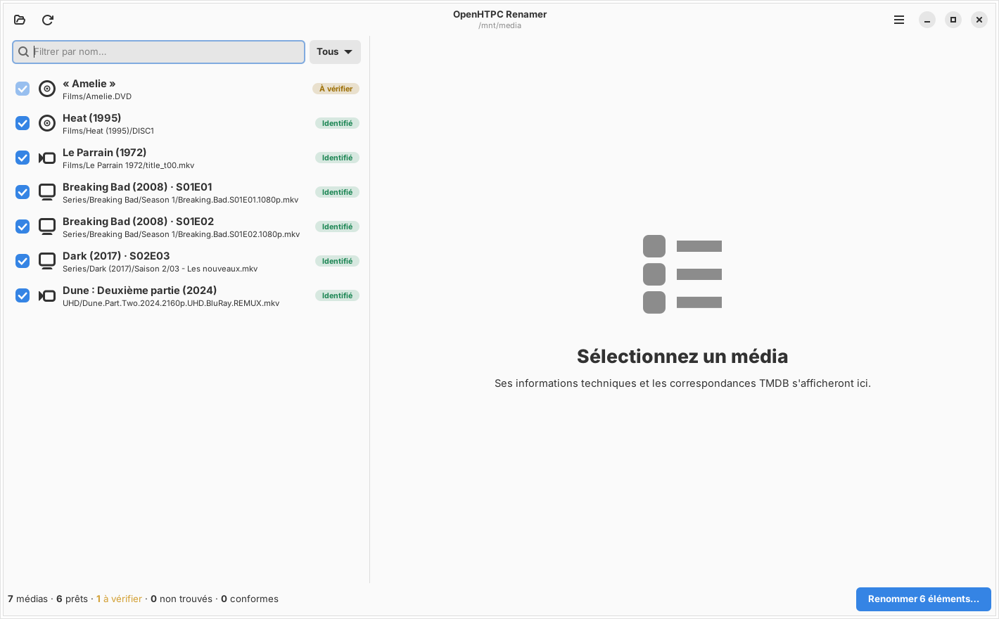
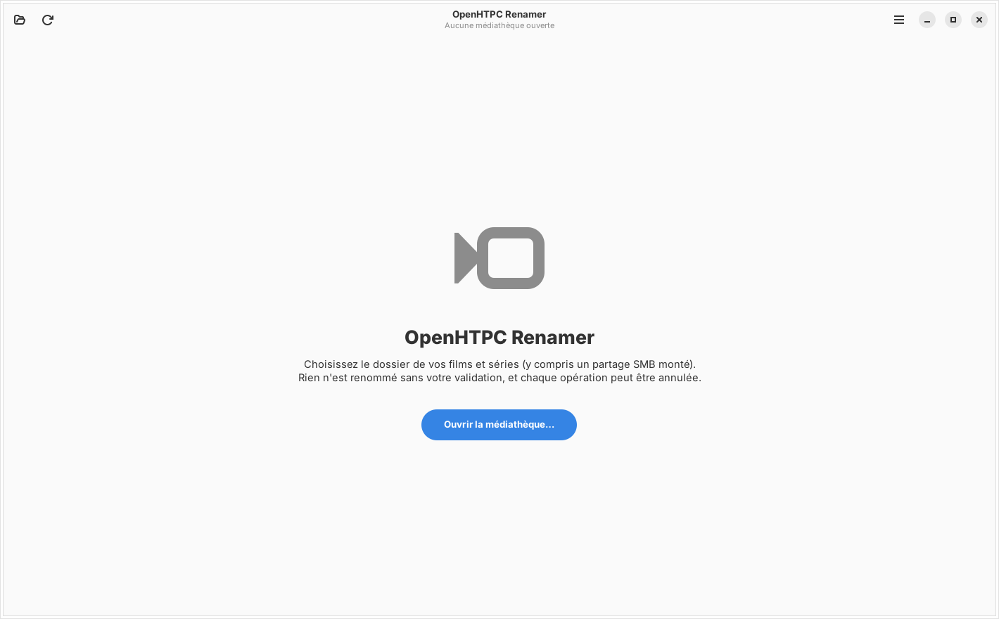
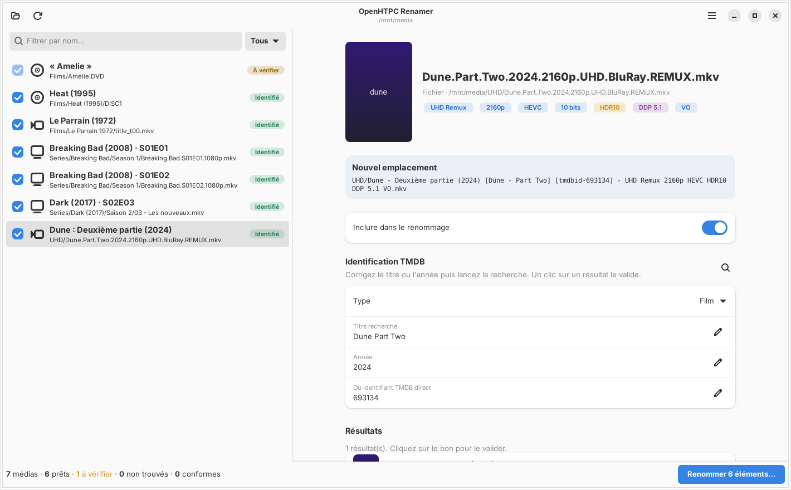
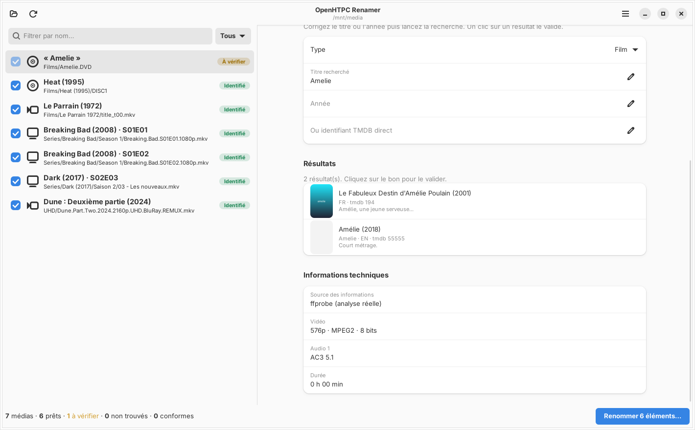
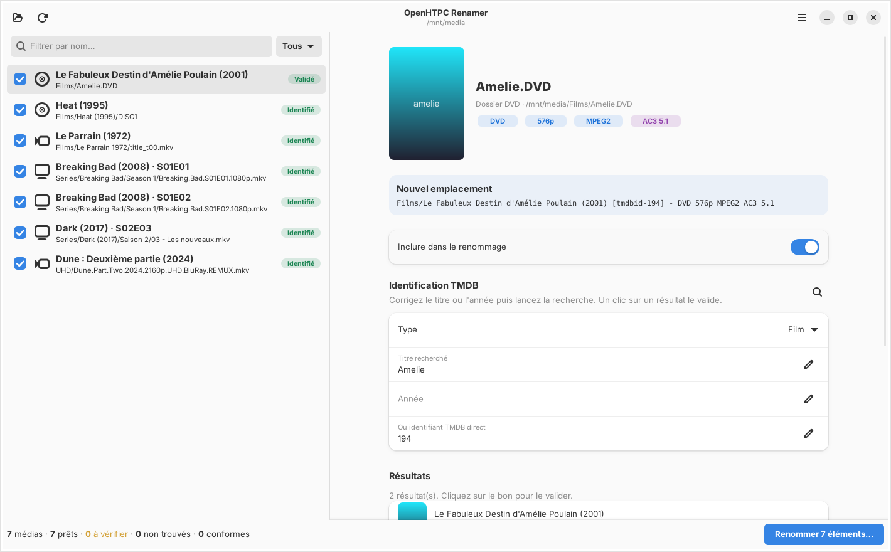
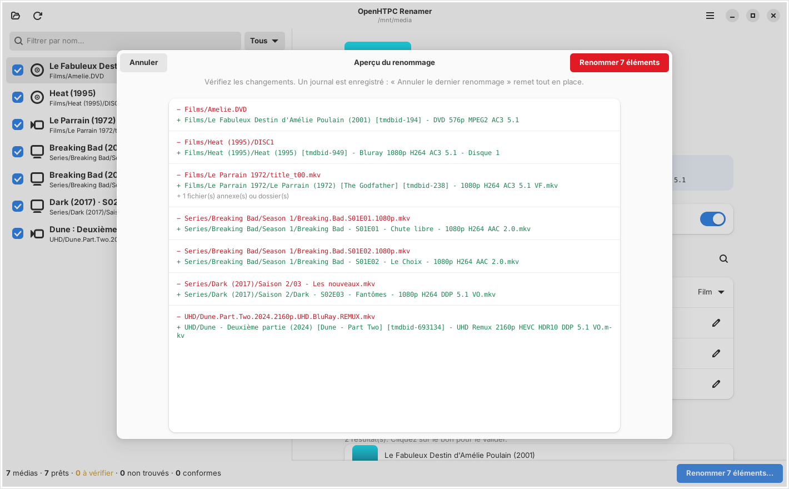
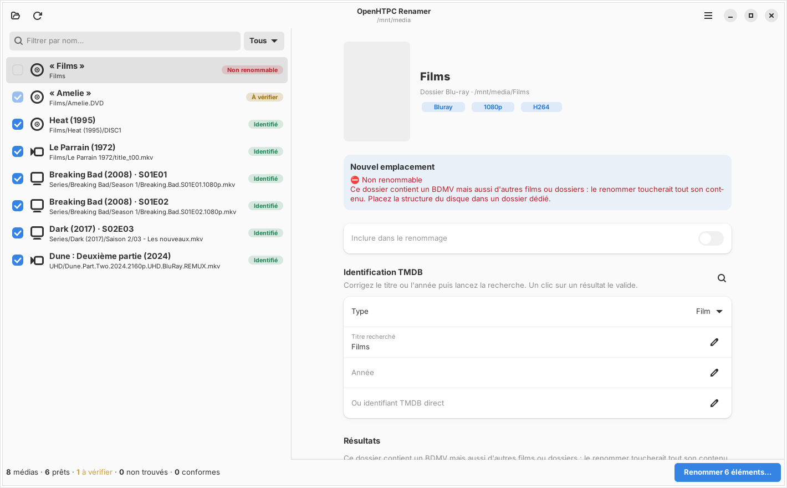
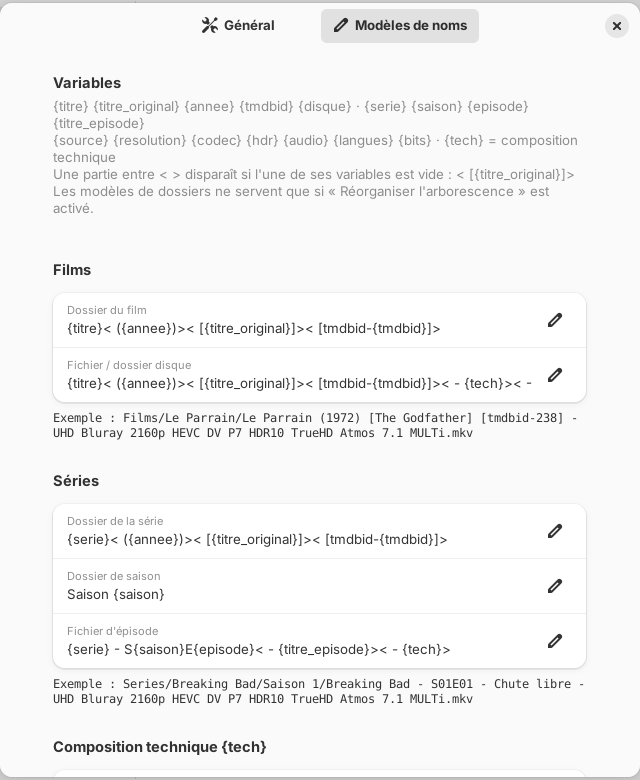

<div align="center">

# 🎬 OpenHTPC Renamer

**Des noms de fichiers que TMDB ne peut pas rater.**

Renommez films, séries, DVD, Blu-ray et UHD avec le bon titre, l'identifiant TMDB
et les vraies caractéristiques techniques : HDR, Dolby Vision, Atmos, DTS-X…

[](https://github.com/loganxwolverine/Renamer/actions/workflows/ci.yml)
[](https://github.com/loganxwolverine/Renamer/releases)


[](LICENSE)



</div>

---

## Le problème

Une médiathèque qui grandit depuis des années finit par ressembler à ceci :

```
Films/Le Parrain 1972/title_t00.mkv            ← nom généré par MakeMKV
Films/Heat (1995)/DISC1/BDMV/…                 ← Blu-ray complet
Films/Amelie.DVD/VIDEO_TS/…                    ← DVD : quel « Amélie » ?
UHD/Dune.Part.Two.2024.2160p.UHD.BluRay.REMUX.mkv
Series/Dark (2017)/Saison 2/03 - Les nouveaux.mkv
```

Un scraper (OpenHTPC, Jellyfin, Plex, Kodi…) doit **deviner** de quel film il s'agit, et il se trompe souvent. Et rien dans ces noms ne dit si le fichier est en Dolby Vision ou si la piste son est en Atmos.

## La solution

OpenHTPC Renamer analyse chaque média, l'identifie sur TMDB avec votre validation, puis le renomme **sur place** :

```
Films/Le Parrain 1972/Le Parrain (1972) [The Godfather] [tmdbid-238] - 1080p H264 AC3 5.1 VF.mkv
Films/Heat (1995)/Heat (1995) [tmdbid-949] - Bluray 1080p H264 AC3 5.1 - Disque 1
Films/Le Fabuleux Destin d'Amélie Poulain (2001) [tmdbid-194] - DVD 576p MPEG2 AC3 5.1
UHD/Dune - Deuxième partie (2024) [Dune - Part Two] [tmdbid-693134] - UHD Remux 2160p HEVC HDR10 DDP 5.1 VO.mkv
Series/Dark (2017)/Saison 2/Dark - S02E03 - Fantômes - 1080p H264 DDP 5.1 VO.mkv
```

Le marqueur **`[tmdbid-XXX]`** supprime toute ambiguïté : le lecteur récupère directement la bonne fiche, sans aucune recherche.

## Points forts

| | |
|---|---|
| 🔍 **Analyse réelle** | Les infos techniques viennent de `ffprobe`, pas du nom du fichier : résolution, codec, 10 bits, **HDR10 / HDR10+ / HLG / Dolby Vision (avec profil)**, **TrueHD Atmos / DTS-X / DTS-HD MA / DDP Atmos**, canaux, langues (MULTi, VF, VO, VOSTFR). |
| 🇫🇷 **Titres français + originaux** | « Le Parrain (1972) [The Godfather] », affiches et résumés TMDB. |
| 🤝 **Vous gardez la main** | Validation automatique seulement quand elle est sûre ; sinon « À vérifier », et vous choisissez en un clic. |
| 📁 **Votre arborescence est respectée** | Par défaut, seuls les noms changent : aucun dossier créé, déplacé ou supprimé. |
| 💿 **Structures disque protégées** | `BDMV` / `VIDEO_TS` ne sont jamais cassés ; un disque mal placé est signalé au lieu d'être renommé. |
| ↩️ **Annulation totale** | Aperçu avant/après, aucun écrasement, journal de chaque opération, **Ctrl+Z** remet tout en place. |
| 🧩 **Modèles de noms** | Le format est entièrement personnalisable, avec un aperçu en direct. |

---

## Guide d'utilisation en images

### 1. Ouvrir la médiathèque

Au premier lancement, choisissez le dossier de vos films et séries. Un partage réseau SMB monté fonctionne aussi ([voir plus bas](#partage-réseau-smb)).



### 2. L'analyse

L'application parcourt les dossiers, analyse chaque fichier avec `ffprobe` puis interroge TMDB. Chaque média reçoit un statut :

| Statut | Signification |
|---|---|
| 🟢 **Identifié** | Titre et année concordent sans ambiguïté |
| 🟡 **À vérifier** | Plusieurs candidats possibles : à vous de choisir |
| 🔴 **Non trouvé / Non renommable** | Aucun résultat, ou structure à ne pas toucher |
| 🔵 **Déjà conforme / Renommé** | Rien à faire |

Les épisodes d'une même série sont identifiés ensemble.


### 3. Le détail d'un média

Un clic sur un média ouvre son détail :
- l'affiche ;
- les caractéristiques techniques détectées (ici un remux UHD **HDR10** en 10 bits) ;
- et surtout, en haut, le **nouveau nom** proposé.



### 4. Lever un doute

« Amelie », sans année, peut désigner plusieurs films. L'application ne choisit pas à votre place : elle affiche les candidats avec affiche, titre original et résumé. Vous pouvez aussi corriger le titre ou l'année, ou saisir directement l'identifiant TMDB.



Un clic sur le bon résultat le **valide**. Pour une série, le choix s'applique à tous ses épisodes.



### 5. Vérifier puis renommer

**Renommer…** affiche la liste complète des changements, en rouge l'ancien nom et en vert le nouveau. Les sous-titres et fichiers `.nfo` qui accompagnent une vidéo sont renommés avec elle. Rien n'est modifié avant votre confirmation.



En cas de regret : **Menu → Annuler le dernier renommage** (ou **Ctrl+Z**). Tout revient exactement comme avant.

### 6. Protection des structures disque

Un Blu-ray ou un DVD rippé est un dossier contenant `BDMV` ou `VIDEO_TS`. L'application renomme **ce dossier**, jamais son contenu, sinon le disque deviendrait illisible. Si une structure disque est mal rangée (ici un `BDMV` posé directement dans `Films`, au milieu des autres films), elle est **bloquée et expliquée** au lieu d'être renommée.



### 7. Personnaliser le format des noms

**Menu → Préférences → Modèles de noms** : chaque partie du nom est modifiable, avec un exemple mis à jour en direct.



| Variable | Exemple |
|---|---|
| `{titre}` / `{serie}` | Le Parrain |
| `{titre_original}` | The Godfather (vide s'il est identique au titre) |
| `{annee}` · `{tmdbid}` · `{disque}` | 1972 · 238 · 2 |
| `{saison}` · `{episode}` · `{titre_episode}` | 01 · 05 (ou `05-E06`) · Chute libre |
| `{source}` | DVD, Bluray, UHD Bluray, Remux, WEB-DL… |
| `{resolution}` · `{codec}` · `{bits}` | 2160p · HEVC · 10bit |
| `{hdr}` | DV P7 HDR10 · HDR10+ · HLG |
| `{audio}` | TrueHD Atmos 7.1 · DTS-HD MA 5.1 |
| `{langues}` | MULTi · VF · VO · VOSTFR |
| `{tech}` | toutes les infos techniques réunies |

Une partie entre `< >` disparaît si l'une de ses variables est vide. Par exemple, `{titre}< [{titre_original}]>` n'ajoute pas de crochets vides quand le titre original est identique au titre.

Une option permet aussi de **réorganiser l'arborescence** (`Film (année)/…`, `Série/Saison XX/…`). Elle est désactivée par défaut.

---

## Installation (Fedora)

### Depuis une release (recommandé)

1. Téléchargez `openhtpc-renamer-…-linux-x86_64.tar.gz` depuis l'onglet [**Releases**](https://github.com/loganxwolverine/Renamer/releases).
2. Lancez :
   ```bash
   tar xzf openhtpc-renamer-*-linux-x86_64.tar.gz
   cd openhtpc-renamer-*-linux-x86_64
   ./install.sh
   ```

L'application apparaît alors dans le menu de vos applications. Le binaire est compilé sur la dernière Fedora ; pour une version plus ancienne, installez depuis les sources.

### Depuis les sources

```bash
git clone https://github.com/loganxwolverine/Renamer.git
cd Renamer
./install.sh
```

Le script installe les dépendances (`rust`, `gtk4-devel`, `libadwaita-devel`, `ffmpeg-free`), compile, puis ajoute le lanceur au menu.

### Clé TMDB

Il faut une clé API TMDB, gratuite : themoviedb.org → *Paramètres* → *API*. Saisissez-la dans **Menu → Préférences**. La clé v3 et le jeton de lecture v4 sont acceptés.

## Partage réseau (SMB)

- **Simple** : ouvrez le partage dans *Fichiers* (Nautilus), puis sélectionnez-le dans l'application. Il apparaît sous `/run/user/1000/gvfs/smb-share:…`.
- **Plus rapide**, recommandé pour une grosse bibliothèque : un montage CIFS.
  ```bash
  sudo dnf install cifs-utils
  sudo mkdir -p /mnt/media
  sudo mount -t cifs //192.168.1.10/Media /mnt/media \
       -o username=VOTRE_USER,uid=$(id -u),gid=$(id -g),iocharset=utf8
  ```

Sur un réseau lent, réduisez *Analyses en parallèle* à 1 ou 2 dans les préférences.

## Mode texte : aperçu sans rien modifier

Idéal pour un premier essai sur une grosse bibliothèque :

```bash
openhtpc-renamer --apercu /mnt/media             # avec identification TMDB
openhtpc-renamer --apercu /mnt/media --sans-tmdb # analyse locale uniquement
```

## Pour les développeurs de lecteurs (OpenHTPC…)

L'identifiant se lit avec une simple expression régulière, puis on appelle directement l'API sans recherche :

```
\[tmdbid-(\d+)\]   →   GET /movie/{id}   ou   GET /tv/{id}
```

## Architecture

```
src/
├── core/
│   ├── scan.rs      parcours, détection DVD / Blu-ray / ISO, protections
│   ├── parse.rs     analyse des noms (titre, année, SxxExx, n° de disque)
│   ├── probe.rs     ffprobe : vidéo, HDR / Dolby Vision, audio, langues
│   ├── tmdb.rs      client TMDB et règles de validation automatique
│   ├── naming.rs    modèles de noms et plan de renommage
│   ├── rename.rs    exécution, journal, annulation
│   └── engine.rs    chaîne d'analyse en parallèle
└── ui/              interface GTK4 / libadwaita
```

```bash
cargo test     # tests unitaires
cargo build --release
```

### Publier une nouvelle version

1. Mettre à jour `version` dans `Cargo.toml` et ajouter une section dans `CHANGELOG.md`.
2. Sur GitHub, ouvrir *Releases* → *Draft a new release*, créer le tag `vX.Y.Z` (ou `vX.Y.Z-rc.N` pour une version candidate, à cocher *pre-release*), puis cliquer sur *Publish*.
3. Le workflow **Release** compile le binaire Fedora, puis attache l'archive et son empreinte SHA-256 à la release.

Les contributions et les retours sont les bienvenus : ouvrez une *issue* en joignant la sortie de `--apercu` pour les cas mal reconnus.

## Licence et crédits

Le code est sous licence [MIT](LICENSE).


Ce produit utilise l'API TMDB mais n'est ni approuvé ni certifié par TMDB.
